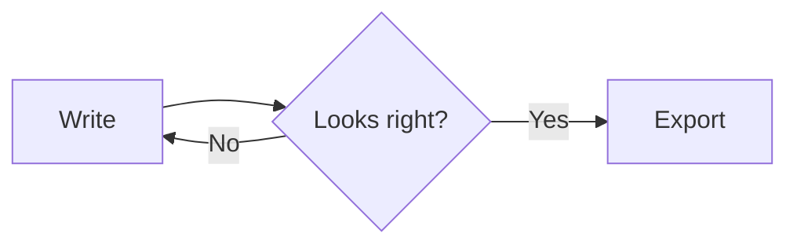

# Markdown Reference

[toc]

## Block elements

### Paragraphs and line breaks

A paragraph is one or more lines of text. Press Enter to start a new paragraph. Press Shift+Enter for a single line break inside a paragraph.

### Headings

```markdown
# Heading 1
## Heading 2
###### Heading 6
```

### Quotes

> A quote starts with `>`.
>
> It can hold several paragraphs, lists and other blocks.

### Lists

- Bullet items start with `-`, `*` or `+`
  - Indent with Tab to nest
- Second item

1. Numbered items start with a number and a dot
2. The numbers continue on their own

- [x] Task items start with `- [ ]` or `- [x]`
- [ ] Click the box to tick it

### Code fences

````markdown
```js
function greet(name) {
  return `Hello, ${name}`
}
```
````

```js
function greet(name) {
  return `Hello, ${name}`
}
```

Name the language after the opening fence to get syntax highlighting.

### Math blocks

```markdown
$$
\mathbf{V}_1 \times \mathbf{V}_2 = \begin{vmatrix}
\mathbf{i} & \mathbf{j} & \mathbf{k} \\
a & b & c \\
d & e & f
\end{vmatrix}
$$
```

$$
\mathbf{V}_1 \times \mathbf{V}_2 = \begin{vmatrix}
\mathbf{i} & \mathbf{j} & \mathbf{k} \\
a & b & c \\
d & e & f
\end{vmatrix}
$$

### Tables

```markdown
| Left | Centered | Right |
| :--- | :------: | ----: |
| a    |    b     |     c |
```

| Left | Centered | Right |
| :--- | :------: | ----: |
| a    |    b     |     c |

### Diagrams

A code fence with the language `mermaid` is drawn as a diagram:



### Other blocks

- `---` or `***` on its own line makes a horizontal line.
- `[toc]` on its own line inserts a table of contents.
- A block between two `---` lines at the very top of the file is YAML front matter.
- `[^1]: Text` defines a footnote, and `[id]: https://example.com "Title"` defines a link reference.

## Inline elements

| Syntax                         | Result                       |
| ------------------------------ | ---------------------------- |
| `**strong**`                   | **strong**                   |
| `*emphasis*`                   | *emphasis*                   |
| `` `code` ``                   | `code`                       |
| `~~strike~~`                   | ~~strike~~                   |
| `==highlight==`                | ==highlight==                |
| `H~2~O`                        | H~2~O                        |
| `x^2^`                         | x^2^                         |
| `<u>underline</u>`             | <u>underline</u>             |
| `$E = mc^2$`                   | $E = mc^2$                   |
| `:smile:`                      | :smile:                      |
| `[link](https://example.com)`  | [link](https://example.com)  |
| `<https://example.com>`        | <https://example.com>        |
| `Footnote[^1]`                 | Footnote[^1]                 |

Images use ``. Paths may be relative to the document.

HTML is allowed: `<span style="color: crimson">text</span>` gives <span style="color: crimson">text</span>, and `<br>` forces a line break.

[^1]: Footnote definitions can live anywhere in the document.
